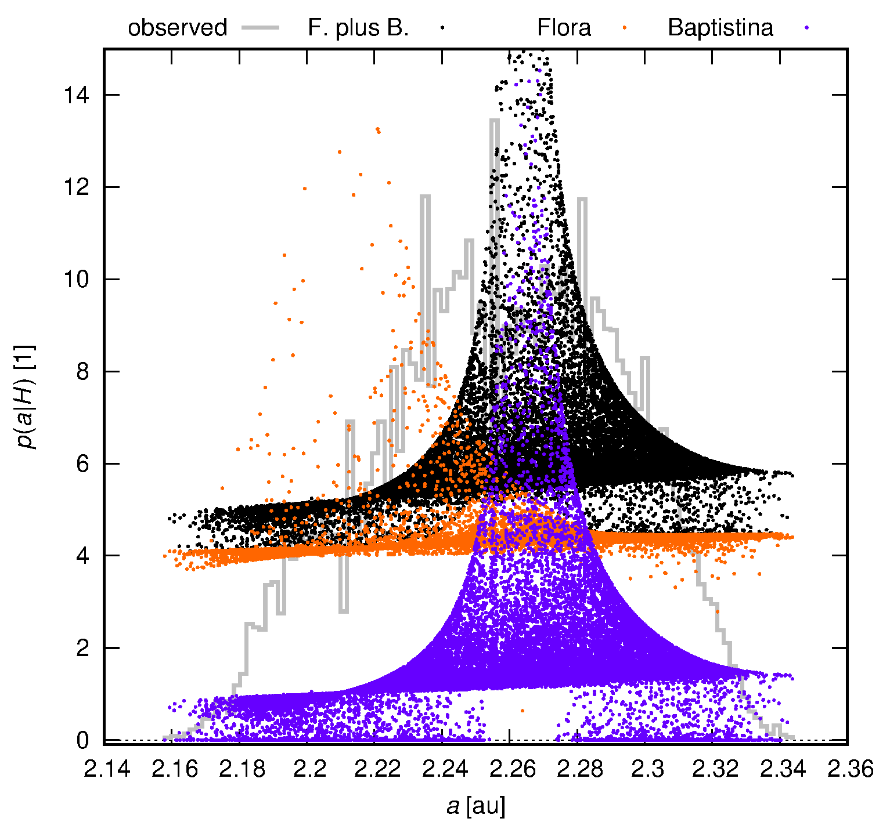
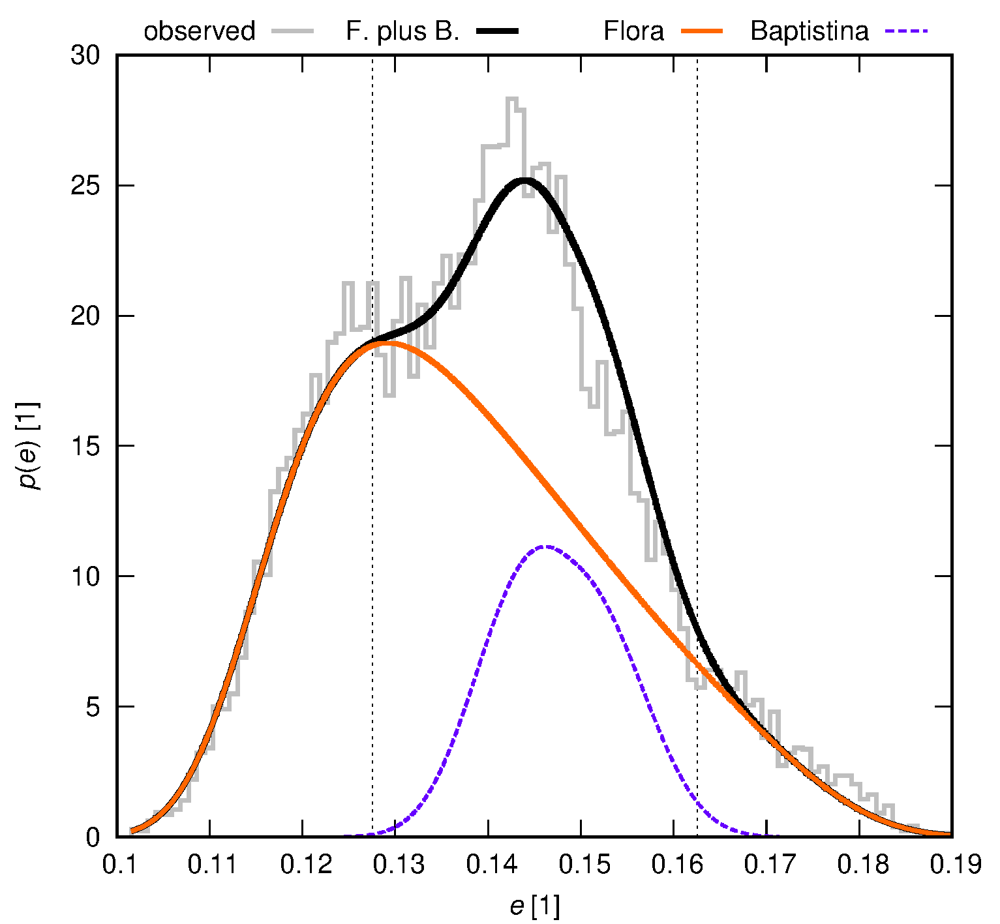
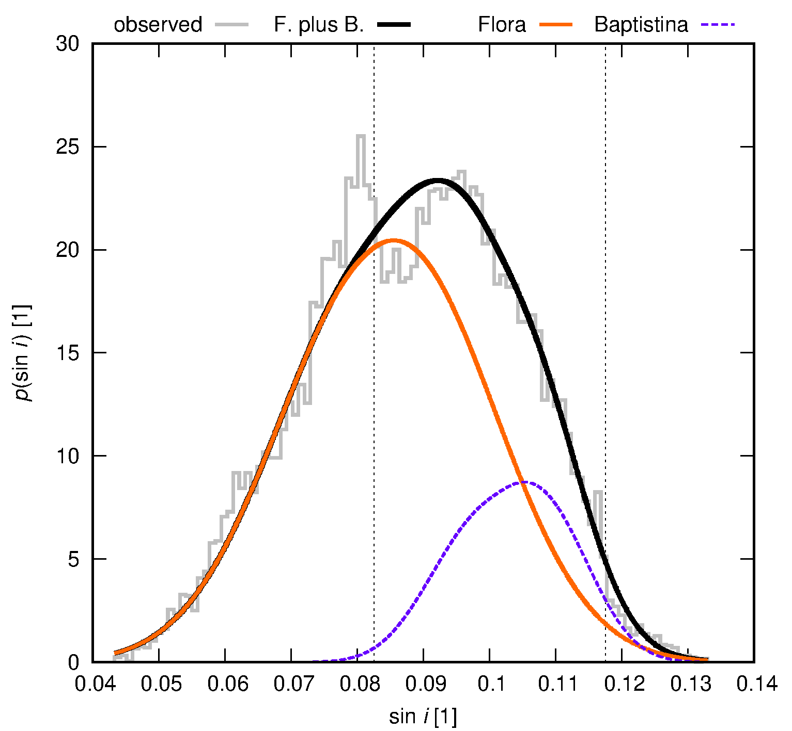
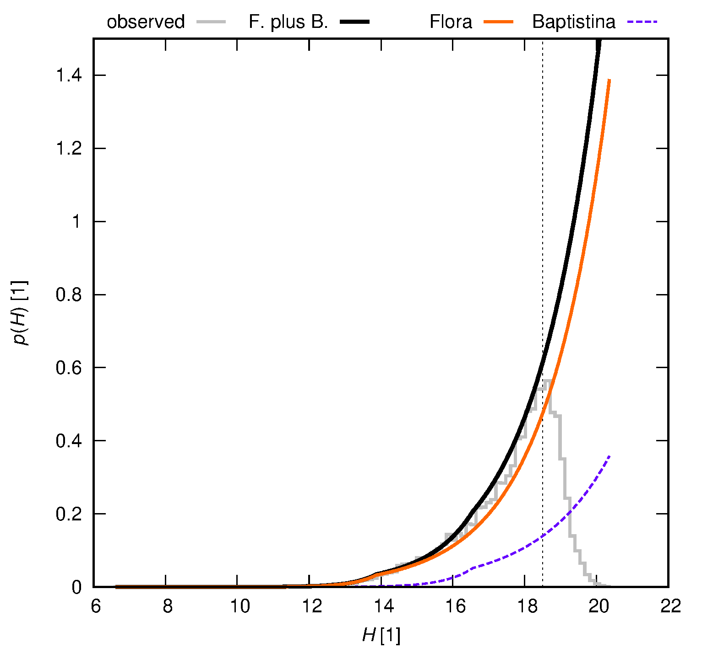
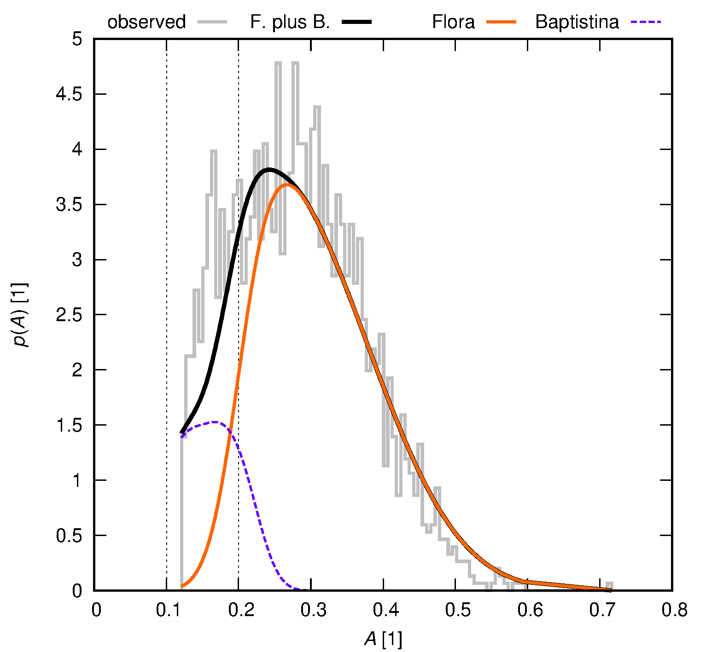

See Vernazza et al. (A&A, submit.), Appendix A: Identification of Flora/Baptistina. MCMC method.

Probabilities *p*(*a*|*H*), *p*(*e*), *p*(sin *i*), *p*(*H*), *p*(*A*)
(coloured lines)
used in the MCMC method
to separate the Flora and Baptistina families.
The observed histograms (gray lines)
were plotted for comparison.
We note that *p(a|H)* is a conditional probability,
consequently individual points do not fit on the marginalized histogram.
The normalization and fitting of *p*(*H*) was done for
*H* = 18.5  mag,
to avoid observational bias,
but eventually the probabilities were computed for all asteroids
(*H* > 18.5 mag).

Corner plot for the 41 parameters
used in the MCMC method
to separate the Flora and Baptistina families.

